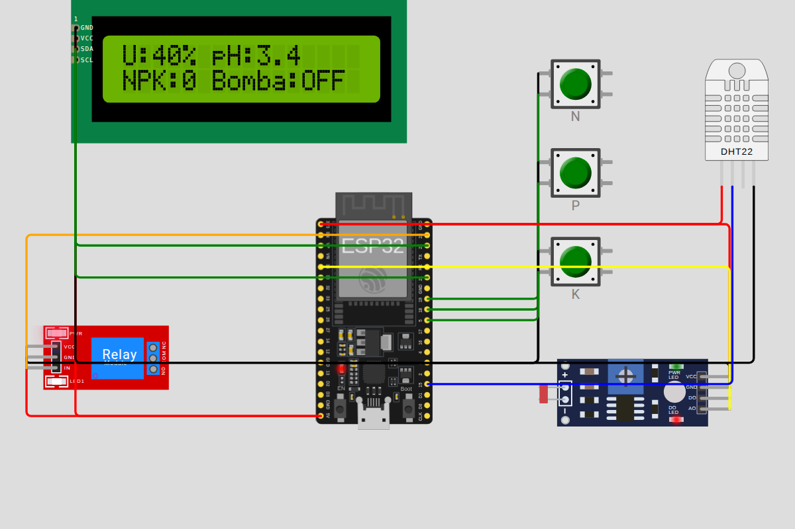
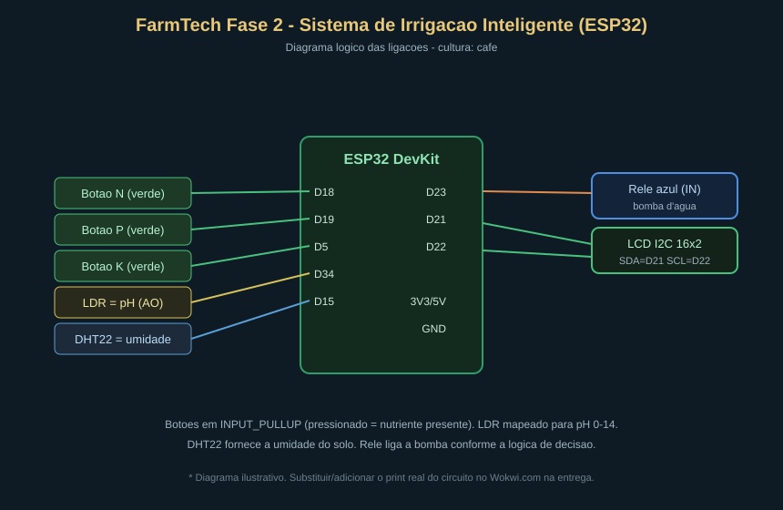

# FarmTech Solutions — Fase 2 · Sistema de Irrigação Inteligente (ESP32)

Projeto da **Fase 2** do curso de Inteligência Artificial e Machine Learning (FIAP).
Dando continuidade à Fase 1 (cálculo de área plantada e monitoramento climático),
a **FarmTech Solutions** agora constrói um **dispositivo IoT de irrigação automatizada**
simulado no [Wokwi.com](https://wokwi.com) com um **ESP32**.

O sistema lê sensores agrícolas (simulados), decide em tempo real se a lavoura
precisa de água e aciona uma bomba (relé). A cultura escolhida é o **café**.

---

## Sumário

1. [Visão geral](#visão-geral)
2. [Substituições didáticas de sensores](#substituições-didáticas-de-sensores)
3. [Circuito e pinagem](#circuito-e-pinagem)
4. [Lógica de decisão da irrigação](#lógica-de-decisão-da-irrigação)
5. [Estrutura de arquivos](#estrutura-de-arquivos)
6. [Como executar no Wokwi](#como-executar-no-wokwi)
7. [Python + OpenWeather](#python--openweather)
8. [Análise estatística em R](#análise-estatística-em-r)
9. [Vídeo de demonstração](#vídeo-de-demonstração)
10. [Requisitos do enunciado atendidos](#requisitos-do-enunciado-atendidos)

---

## Visão geral

| O quê | Como |
|---|---|
| Nutrientes **N, P, K** | 3 botões verdes — presente (pressionado) ou ausente |
| **pH** do solo | Sensor de luz **LDR**, mapeado para a escala 0–14 |
| **Umidade** do solo | **DHT22** (umidade do ar usada como umidade do solo) |
| **Bomba d'água** | **Relé azul** acionado por GPIO |
| **Painel** | **LCD I2C 16×2** mostrando umidade, pH, NPK e estado da bomba |
| Previsão de **chuva** | Python consulta a **OpenWeather** e repassa ao ESP32 via Serial |

O ESP32 lê os sensores a cada 2 segundos, aplica a lógica de decisão e liga/desliga
a bomba, imprimindo tudo no Monitor Serial e no LCD.

---

## Substituições didáticas de sensores

Como o Wokwi não tem sensores agrícolas reais, usamos as substituições pedidas no enunciado:

- **N, P, K → 3 botões verdes.** Leitura booleana (tudo ou nada): pressionado = nutriente presente.
- **pH → LDR.** O valor analógico do LDR (0–4095 no ESP32) é mapeado para **pH 0–14**
  (`pH = leitura / 4095 × 14`). Mexer na luz do LDR simula alterar o pH do solo — exatamente
  como o enunciado pede: *ao mexer no NPK, ajustar o LDR para refletir a mudança de pH*.
- **Umidade → DHT22.** O DHT22 mede umidade do ar; aqui ela representa a **umidade do solo**.

---

## Circuito e pinagem

**Circuito montado no Wokwi** ([abrir o projeto](https://wokwi.com/projects/477723225635026945)):



**Diagrama lógico das ligações:**



| Componente | Pino do componente | GPIO do ESP32 |
|---|---|---|
| Botão N | perna → GND / perna → GPIO | **D18** (INPUT_PULLUP) |
| Botão P | perna → GND / perna → GPIO | **D19** (INPUT_PULLUP) |
| Botão K | perna → GND / perna → GPIO | **D5**  (INPUT_PULLUP) |
| LDR (pH) | AO | **D34** (entrada analógica) |
| DHT22 | SDA/DATA | **D15** |
| Relé (bomba) | IN | **D23** |
| LCD I2C | SDA / SCL | **D21 / D22** |

Alimentação: LDR e DHT22 em **3V3**; relé e LCD em **5V**; todos os GNDs em comum.

---

## Lógica de decisão da irrigação

A regra de acionamento da bomba é **do grupo** e foi calibrada para o **café**, que
prefere solo levemente ácido e úmido (não encharcado).

**Parâmetros agronômicos adotados (café):**

| Parâmetro | Faixa | Fonte/razão |
|---|---|---|
| pH ideal | **5,0 – 6,5** | café produz bem em solo levemente ácido |
| Solo seco | umidade **< 40%** | abaixo disso o solo precisa de água |
| Solo úmido | umidade **≥ 60%** | acima disso não irriga (evita encharcar) |
| Café bem nutrido (N+P+K) | limiar seco sobe p/ **45%** | planta em crescimento consome mais água |

**Fluxo de decisão (implementado em `decidirBomba()`):**

```
1. Chuva prevista?            → SIM  → bomba DESLIGADA (economia de água)
2. Umidade ≥ 60%?             → SIM  → bomba DESLIGADA (solo já úmido)
3. Umidade < limiar seco?     → SIM  → liga SE o pH estiver em 5,0–6,5
                                        (pH fora da faixa: não irriga e alerta)
4. Zona morta (limiar–60%)    →        mantém o estado anterior (histerese)
```

- **NPK na decisão:** quando **N, P e K** estão todos presentes, o limiar de "solo seco"
  sobe de 40% para **45%** — o café bem adubado transpira/consome mais, então regamos mais cedo.
- **Alertas:** se houver menos de 2 nutrientes presentes, o sistema avisa "aplicar adubação NPK";
  se o pH sair da faixa, avisa "corrigir pH antes de irrigar".
- **Histerese (40–60%):** evita o relé ficar ligando e desligando toda hora perto do limite.

---

## Estrutura de arquivos

```
fase2/
├── README.md                      # este arquivo
├── wokwi/
│   ├── sketch.ino                 # código C/C++ do ESP32
│   ├── diagram.json               # circuito do Wokwi (abre pronto)
│   └── libraries.txt              # bibliotecas (DHT, LiquidCrystal_I2C)
├── ir_alem_python/
│   └── clima_openweather.py       # previsão de chuva (OpenWeather)
├── ir_alem_r/
│   ├── analise_irrigacao.R        # estatística + regressão logística
│   └── leituras.csv               # histórico de leituras (amostra)
└── docs/
    ├── circuito.svg               # diagrama lógico das ligações
    └── wokwi_circuito.png         # print do circuito rodando no Wokwi
```

---

## Como executar no Wokwi

1. Acesse [wokwi.com](https://wokwi.com) → **New Project** → **ESP32**.
2. Substitua o conteúdo de `sketch.ino` pelo arquivo deste repositório.
3. Abra a aba **diagram.json** e cole o `wokwi/diagram.json` (monta o circuito automaticamente).
4. Clique em **▶ (play)**. O LCD mostra o status e o Monitor Serial imprime as leituras.
5. **Interaja:** pressione os botões N/P/K, mexa na luz do LDR (pH) e no DHT22 (umidade) e
   observe a bomba (relé) ligar/desligar.
6. **Previsão de chuva:** no Monitor Serial, digite `C` (chuva → suspende) ou `S` (sem chuva).

---

## Python + OpenWeather

`ir_alem_python/clima_openweather.py` consulta a previsão do tempo e decide se há
chuva nas próximas horas. Como a integração automática Python↔Wokwi não é trivial no
plano gratuito, **transferimos o resultado manualmente**: o script imprime o caractere
(`C` ou `S`) para colar no Monitor Serial do ESP32 (lido por `Serial.read()`).

```bash
export OPENWEATHER_API_KEY="sua_chave"
python3 clima_openweather.py --cidade "Campinas,BR" --horas 12
```

Sem chave de API o script roda em **modo demo** (dados simulados), então a
demonstração funciona mesmo offline. Saída de exemplo:

```
RESULTADO: HA previsao de chuva -> SUSPENDER irrigacao.
>>> Cole este caractere no Monitor Serial do ESP32 (Wokwi): C
```

No firmware, `C` seta `chuvaPrevista = true` e a bomba nunca liga enquanto houver
chuva prevista — exatamente o comportamento de economia pedido no enunciado.

---

## Análise estatística em R

`ir_alem_r/analise_irrigacao.R` lê o histórico `leituras.csv`, calcula estatísticas
descritivas e ajusta uma **regressão logística** que estima a probabilidade de a
bomba precisar ser ligada a partir de **umidade, pH e NPK**.

```bash
cd ir_alem_r && Rscript analise_irrigacao.R
```

Resultado (amostra atual): a umidade tem correlação **negativa** com o acionamento
(quanto mais seco, mais irriga) e o NPK, **positiva** — confirmando a lógica do
firmware. Para a leitura nova `umidade=34% / pH=5,8 / NPK=3`, o modelo estima **~83%**
de probabilidade e decide **LIGAR a bomba**.

---

## Vídeo de demonstração

[Assistir no YouTube](https://youtube.com/shorts/oImNKx62skk)

---

## Requisitos do enunciado atendidos

- [x] **3 botões** simulando níveis de N, P e K (true/false)
- [x] **LDR** representando o pH do solo (escala 0–14)
- [x] **DHT22** como sensor de umidade do solo
- [x] **Relé azul** representando a bomba d'água
- [x] Lógica de irrigação combinando **umidade + pH + NPK + chuva** (documentada)
- [x] Código **C/C++** para o ESP32 (`wokwi/sketch.ino`)
- [x] **README.md** em Markdown com imagem do circuito
- [x] **Ir Além 1:** integração Python + API pública (OpenWeather) via Serial
- [x] **Ir Além 2:** análise estatística em R (descritiva + regressão logística)
- [x] **Vídeo** no YouTube ([link](https://youtube.com/shorts/oImNKx62skk))
- [x] **Print real do circuito no Wokwi** (`docs/wokwi_circuito.png`)

---

*FarmTech Solutions — Fase 2 · Curso de IA e Machine Learning (FIAP).*
