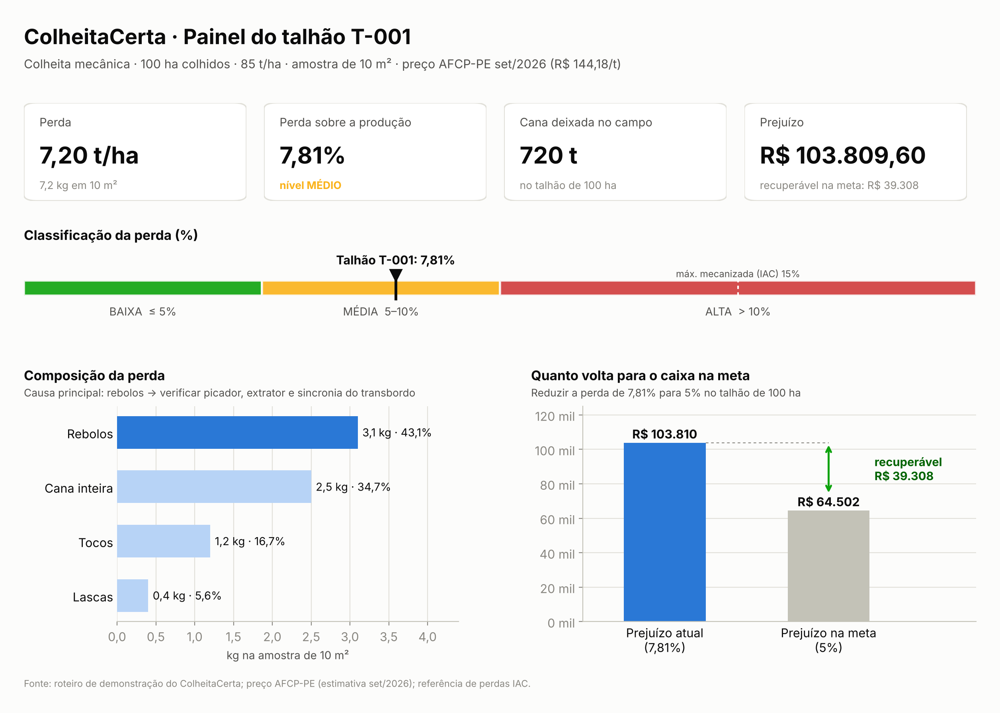
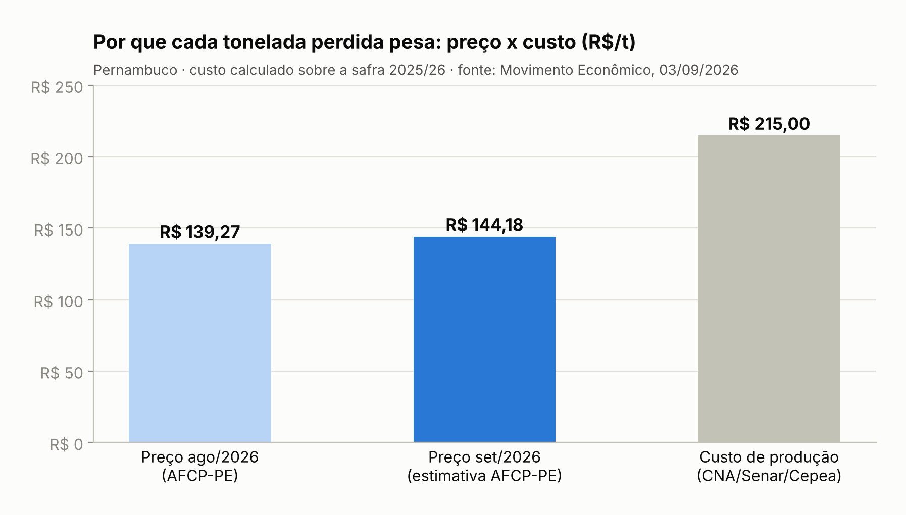
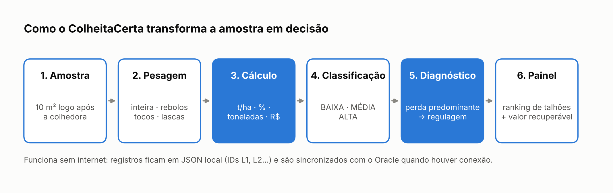
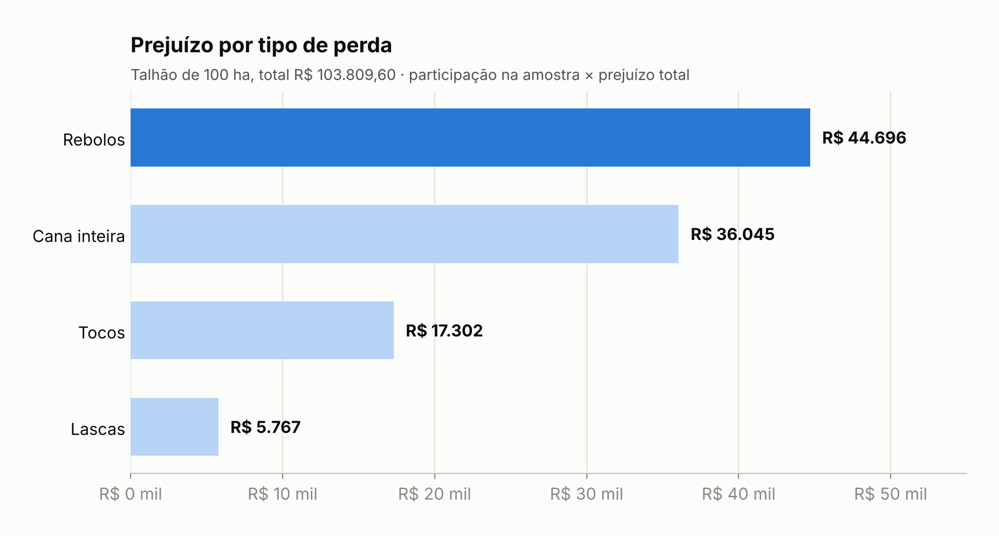
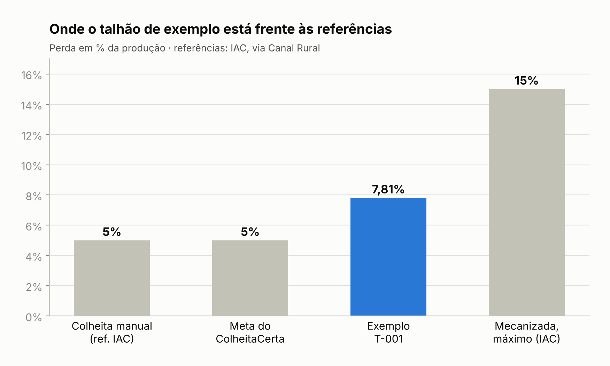
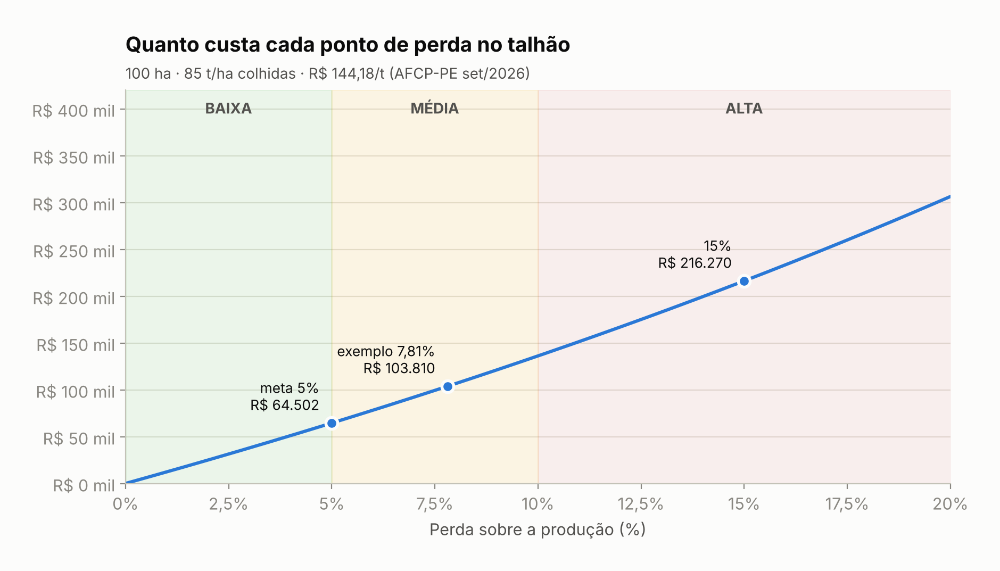
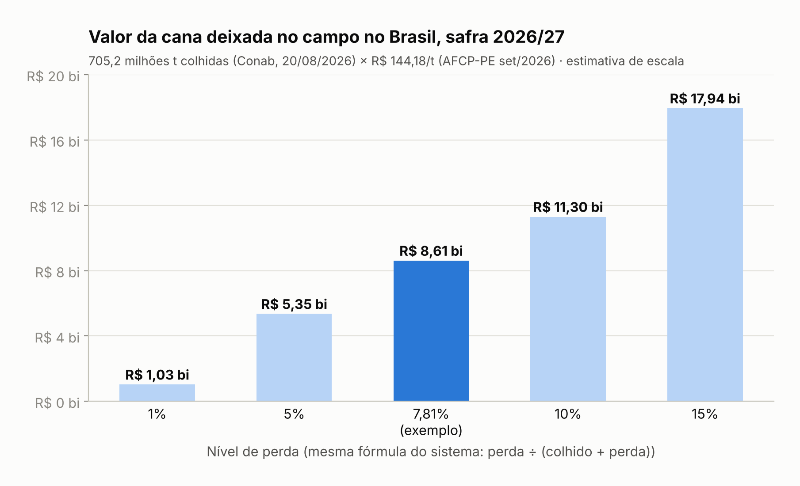

# FIAP - Faculdade de Informática e Administração Paulista

## ColheitaCerta: Monitor de Perdas na Colheita de Cana-de-Açúcar

Sistema em Python que transforma a amostragem de perdas feita no campo em diagnóstico da colhedora, prejuízo em reais e meta de recuperação, funcionando inclusive sem internet.



### Nome do grupo

FJDJV

#### 👥 Integrantes

- Fernanda Leticia da Silva – RM576269
- João Victor Veneno – RM574509
- Deniel Reinaldo Barbosa – RM574459
- José Jurs Gomes Filho – RM576707
- Vitória Alves Melo de Oliveira – RM574762

#### 👨‍🏫 Professores

- **Tutor(a):** Sabrina Otoni
- **Professor(a):** Edson Oliveira

---

## Sumário

1. [Descrição](#descrição)
2. [Metodologia de cálculo](#metodologia-de-cálculo)
3. [Diagnóstico pela composição da perda](#diagnóstico-pela-composição-da-perda)
4. [Exemplo de resultado](#exemplo-de-resultado)
5. [Dashboards](#dashboards)
6. [Conteúdos da disciplina aplicados](#conteúdos-da-disciplina-aplicados-capítulos-3-a-6)
7. [Consistência dos dados de entrada](#consistência-dos-dados-de-entrada)
8. [Estrutura de pastas](#estrutura-de-pastas)
9. [Como executar](#como-executar-o-código)
10. [Limitações e próximos passos](#limitações-e-próximos-passos)
11. [Referências](#referências)

---

## Descrição

### O problema: a cana que fica no campo

O Brasil é o maior produtor mundial de cana-de-açúcar. Para a safra 2026/27, a Conab estima **705,2 milhões de toneladas** em **9,1 milhões de hectares**, com produtividade média de 77,9 t/ha, alta de 4,7% sobre a safra anterior (2º levantamento, 20/08/2026).

Mesmo assim, uma parte relevante do que é plantado **nunca chega à usina**. Segundo pesquisa do IAC (Instituto Agronômico de Campinas), as perdas na colheita mecanizada **chegam a 15%**, contra cerca de **5% na colheita manual**. A literatura acadêmica confirma a mesma ordem de grandeza (José, EPCC/Unicesumar, 2009). Essa cana fica no chão como cana inteira, rebolos (pedaços), tocos e lascas.

E a conta fica mais apertada porque, hoje, o produtor já vende abaixo do custo: em Pernambuco, a tonelada de cana foi vendida a R$ 139,27 em agosto/2026, enquanto o custo de produção chegou a R$ 215/t (estudo CNA/Senar/Cepea, base safra 2025/26). Cada tonelada perdida é custo já pago que não vira receita.



**O tamanho do problema, em números reais:**

| Indicador | Valor | Fonte / cálculo |
|---|---|---|
| Produção estimada 2026/27 | 705,2 milhões t | Conab, 20/08/2026 |
| Preço de referência da tonelada de cana | R$ 144,18/t | AFCP-PE (modelo Consecana), estimativa set/2026 |
| Custo de produção da tonelada | R$ 215,00/t | CNA/Senar/Cepea, base 2025/26 (citado pela AFCP-PE) |
| Cana perdida a 1% de perda | ≈ 7,12 milhões t | 705,2 × 1% ÷ 99% |
| Valor perdido a 1% de perda | ≈ R$ 1,03 bilhão | 7,12 milhões t × R$ 144,18 |

Estimativa de escala, calculada com a mesma fórmula do sistema (perda ÷ (colhido + perda)). O preço da cana varia por estado e por mês; o preço de Pernambuco é usado como referência porque é a fonte pública mais recente encontrada para setembro/2026.

Mesmo assim, na maioria das propriedades ninguém mede essa perda de forma sistemática. Sem dados, o produtor não sabe:

- **quanto** está perdendo, em toneladas e em reais;
- **onde**: quais talhões e quais operações são os mais críticos;
- **por quê**: qual regulagem da colhedora deve corrigir.

### A solução

O **ColheitaCerta** é um sistema em Python, operado pelo prompt de comando, que transforma a amostragem de perdas feita no campo em diagnóstico e decisão:



1. O técnico demarca uma **área de amostra** (ex.: 10 m²) logo após a passagem da colhedora, recolhe a cana que ficou no chão e **pesa separadamente** cana inteira, rebolos, tocos e lascas.
2. O sistema calcula a perda em **t/ha**, em **% da produção**, em **toneladas no talhão** e em **R$**.
3. Classifica a perda em **BAIXA / MÉDIA / ALTA** e, pelo tipo de perda predominante, aponta a **causa provável** e a **regulagem a verificar** na colhedora.
4. Um **painel gerencial** compara colheita manual x mecânica, ranqueia os talhões mais críticos e calcula **quanto dinheiro seria recuperado** se a perda caísse até a meta.

### Público-alvo

- **Fornecedores de cana e usinas** que precisam saber quanto perdem e onde.
- **Técnicos agrícolas e encarregados de frente de colheita**, que fazem a amostragem no campo.
- **Gestores**, que precisam justificar investimento em treinamento de operadores e manutenção de máquinas.

### Inovação

- **Diagnóstico pela composição da perda.** O sistema não informa apenas "perdeu 8%". Ele identifica *o que* mais foi perdido e *o que verificar* (veja a tabela de diagnóstico).
- **Valor recuperável na meta.** Traduz a perda em uma meta financeira concreta, o que facilita justificar investimento.
- **Funciona sem internet (modo offline).** O campo muitas vezes não tem sinal. Os registros ficam salvos localmente em JSON, marcados como pendentes (IDs L1, L2...), e são sincronizados com o Oracle quando houver conexão.

---

## Metodologia de cálculo

| Indicador | Fórmula |
|---|---|
| Perda (t/ha) | kg recolhidos na amostra ÷ área da amostra (m²) × 10 (1 kg/m² = 10 t/ha) |
| Perda (%) | perda t/ha ÷ (produtividade colhida t/ha + perda t/ha) × 100 |
| Toneladas perdidas | perda t/ha × área colhida (ha) |
| Prejuízo (R$) | toneladas perdidas × preço da tonelada (configurável) |
| Perda máxima da meta (t/ha) | meta% × produtividade ÷ (1 − meta%) |
| Recuperável na meta (R$) | (perda atual t/ha − perda máxima da meta t/ha) × área × preço |

### Faixas de classificação

| Nível | Faixa | Leitura | Base |
|---|---|---|---|
| **BAIXA** | perda ≤ 5% | Dentro da referência da colheita manual | 5% = perda da colheita manual (IAC) |
| **MÉDIA** | 5% < perda ≤ 10% | Revisar a regulagem da operação | ponto médio entre a referência manual e o máximo da mecanizada (critério do projeto) |
| **ALTA** | perda > 10% | Intervenção imediata | aproxima-se do máximo de 15% citado pelo IAC para a mecanizada |

O preço da tonelada (padrão **R$ 144,18**, valor de referência da AFCP-PE para setembro/2026) e a meta (padrão **5%**) podem ser alterados no menu *Configurações* ou em `config/config.json`. O ideal é usar o valor Consecana vigente da região do produtor.

---

## Diagnóstico pela composição da perda

A perda predominante na amostra aponta a parte da colhedora a verificar. As recomendações são **hipóteses para conferir em campo**, não um laudo da máquina.

| Perda predominante | Causa provável | O que verificar |
|---|---|---|
| **Tocos** | corte de base alto ou facas desgastadas | altura do cortador de base, estado e afiação das lâminas |
| **Rebolos** | fragmentação no processamento ou falha no transbordo | rotação do extrator primário, rolos picadores e sincronia colhedora–transbordo |
| **Cana inteira** | cana não recolhida pela máquina | divisores de linha, velocidade de deslocamento e alinhamento com a linha de plantio |
| **Lascas** | corte por impacto, que dilacera a cana | tipo de lâmina e qualidade do corte |

> Mantenha esta tabela igual ao dicionário `RECOMENDACOES` em `src/calculos.py`.

---

## Exemplo de resultado

Entrada do roteiro de demonstração: colheita **mecânica**, **100 ha** colhidos, produtividade de **85 t/ha**, amostra de **10 m²**, preço **R$ 144,18/t**.

| Tipo de perda | Peso na amostra | Participação | Prejuízo |
|---|---|---|---|
| Rebolos | 3,1 kg | 43,1% ← causa principal | R$ 44.695,80 |
| Cana inteira | 2,5 kg | 34,7% | R$ 36.045,00 |
| Tocos | 1,2 kg | 16,7% | R$ 17.301,60 |
| Lascas | 0,4 kg | 5,6% | R$ 5.767,20 |
| **Total** | **7,2 kg** | **100%** | **R$ 103.809,60** |

| Indicador | Resultado | Conta |
|---|---|---|
| Perda | **7,20 t/ha** | 7,2 kg ÷ 10 m² × 10 |
| Perda (%) | **7,81% → MÉDIA** | 7,2 ÷ (85 + 7,2) × 100 |
| Toneladas perdidas | **720 t** | 7,2 t/ha × 100 ha |
| Prejuízo | **R$ 103.809,60** | 720 t × R$ 144,18 |
| Perda máxima na meta de 5% | 4,47 t/ha | 0,05 × 85 ÷ 0,95 |
| Recuperável na meta | **≈ R$ 39.308** | (7,20 − 4,47) t/ha × 100 ha × R$ 144,18 |

**Diagnóstico:** perda MÉDIA com predominância de rebolos → verificar extrator, rolos picadores e sincronia do transbordo.

---

## Dashboards

Todos os gráficos são imagens geradas por `scripts/gerar_graficos.py` a partir do roteiro de demonstração e das fontes citadas em [Referências](#referências). Para regenerar: `pip install matplotlib` e `python scripts/gerar_graficos.py`.

**1. Painel do talhão** — reúne os quatro indicadores, a classificação, a composição da perda e o valor recuperável (imagem no topo do README).

**2. Prejuízo por tipo de perda** — os rebolos respondem por quase metade do prejuízo, por isso são o primeiro alvo de regulagem.



**3. O exemplo frente às referências**



**4. Quanto custa cada ponto de perda no talhão** — na faixa MÉDIA (5% a 10%), cada ponto percentual a mais custa entre R$ 13,6 mil e R$ 15,1 mil neste talhão de 100 ha.



**5. A escala do problema no Brasil**



---

## Conteúdos da disciplina aplicados (capítulos 3 a 6)

| Conteúdo | Onde está no código |
|---|---|
| **Funções com retorno** | `calculos.py` (`calcular_perda_t_ha`, `classificar_perda`, `ranking_talhoes`...), `validacoes.py` (`ler_float`, `ler_data`...) |
| **Procedimentos com passagem de parâmetros** | `interface.py` (`cabecalho`, `imprimir_tabela`), `arquivos.py` (`registrar_log`), `main.py` (`exibir_resultado`, `cadastrar_talhao`...) |
| **Listas** | lista de colheitas; lista de participação de cada tipo de perda; ranking de talhões |
| **Tuplas** | `TIPOS_PERDA`, `FAIXAS_PERDA`, `OPCOES_MENU`, retorno `(nível, descrição)` e itens do ranking `(talhão, %, R$)` |
| **Dicionários** | talhões `{código: dados}`, `RECOMENDACOES`, `TIPOS_COLHEITA`, menu `{opção: função}`, configuração |
| **Tabela de memória** | `estado["colheitas"]`: lista de dicionários carregada do Oracle/JSON e consultada, filtrada e agregada em memória |
| **Arquivo texto** | `data/log_operacoes.txt` (append, com leitura das últimas linhas no menu 13) e `data/relatorio_*.txt` |
| **Arquivo JSON** | `config/config.json` (leitura/gravação), `data/base_local.json` (modo offline) e `data/resumo_*.json` |
| **Banco de dados Oracle** | `banco.py`: conexão oracledb, criação automática das tabelas, INSERT / SELECT / UPDATE / DELETE com bind variables e RETURNING ... INTO |

---

## Consistência dos dados de entrada

Nenhum dado chega ao cálculo ou ao banco sem validação. Todas as leituras **repetem a pergunta até receber um valor válido**:

- números aceitam vírgula ou ponto e respeitam limites (ex.: produtividade entre 20 e 250 t/ha, peso da amostra entre 0 e 500 kg);
- a área colhida não pode ser maior que a área do talhão;
- datas no formato dd/mm/aaaa, sem datas futuras;
- código do talhão no padrão T-001 / AB12, sem duplicidade;
- opções só dentro do conjunto permitido (MEC / MAN, S / N, itens do menu);
- não é possível excluir um talhão que tenha colheitas registradas;
- um alerta pede conferência quando a perda calculada passa de 40%;
- arquivos JSON corrompidos são isolados sem derrubar o programa.

---

## Estrutura de pastas

```
.
├── .github/                 # configurações do GitHub
├── assets/
│   └── graficos/            # gráficos e painel usados neste README
├── config/
│   └── config.json          # preço da tonelada, meta de perda, área da amostra, DSN do Oracle
├── data/                    # gerada pelo sistema (base local, log, relatórios) — não versionada
├── document/                # documentos do projeto
├── scripts/
│   ├── criar_tabelas.sql    # DDL das tabelas e consultas de apoio
│   └── gerar_graficos.py    # gera os gráficos do README (requer matplotlib)
├── src/
│   ├── main.py              # menu e fluxo principal
│   ├── calculos.py          # regras de negócio (perdas, classificação, diagnóstico, indicadores)
│   ├── validacoes.py        # leitura e consistência das entradas
│   ├── arquivos.py          # manipulação de arquivos texto e JSON
│   ├── banco.py             # conexão e operações no Oracle
│   └── interface.py         # tabelas, barras e números no padrão brasileiro
├── requirements.txt         # dependência: oracledb
└── README.md
```

---

## Como executar o código

**Pré-requisitos:** Python 3.10 ou superior e acesso ao Oracle da FIAP (usuário RM e senha).

```bash
# 1. Clonar o repositório
git clone <url-do-repositorio>
cd <pasta-do-repositorio>

# 2. (Opcional) criar ambiente virtual
python -m venv .venv
# Windows: .venv\Scripts\activate | Linux/Mac: source .venv/bin/activate

# 3. Instalar a dependência
pip install -r requirements.txt

# 4. Executar
python src/main.py
```

Ao iniciar, o programa pergunta se deve conectar ao Oracle e solicita usuário e senha (a senha não aparece na tela e não fica gravada no código). As tabelas `T_CC_TALHAO` e `T_CC_COLHEITA` são criadas automaticamente na primeira conexão.

> Opcional: defina as variáveis de ambiente `ORACLE_USER` e `ORACLE_PASSWORD` para não digitar as credenciais a cada execução.

Se a conexão falhar ou o usuário escolher não conectar, o sistema funciona em **modo offline** e os registros são enviados ao banco depois, pela opção **12 – Conectar / sincronizar com o Oracle**.

### Principais opções do menu

| Opção | Função |
|---|---|
| 1 | Cadastrar talhão |
| 5 | Registrar amostragem de perdas |
| 9 | Painel gerencial |
| 10 | Exportar relatório (TXT/JSON) |
| 12 | Conectar / sincronizar com o Oracle |
| 13 | Ver últimas linhas do log |

### Roteiro sugerido para demonstração

1. **Cadastrar talhão** (opção 1): T-001, Fazenda Boa Vista, 120 ha, RB867515.
2. **Registrar amostragem** (opção 5): colheita mecânica, 100 ha, 85 t/ha, amostra de 10 m² com 2,5 kg de cana inteira, 3,1 kg de rebolos, 1,2 kg de tocos e 0,4 kg de lascas. Resultado esperado: perda de 7,81% (MÉDIA), 720 t perdidas, R$ 103.809,60 de prejuízo, com rebolos como causa principal.
3. Registrar uma colheita **manual** em outro talhão para comparar.
4. Abrir o **Painel gerencial** (opção 9) e exportar o relatório (opção 10).
5. (Opcional) Desconectar a rede, registrar uma amostragem em modo offline e depois sincronizar pela opção 12.

---

## Limitações e próximos passos

- **Amostragem pontual:** a estimativa depende da representatividade da área amostrada. Recomenda-se mais de uma amostra por talhão e o uso da média.
- **Perdas invisíveis** (caldo e fragmentos finos lançados pelo extrator) não são capturadas pela pesagem no chão.
- **Diagnóstico por regras:** as recomendações são hipóteses a verificar em campo, não um laudo da máquina.
- **Preço regional:** o preço padrão é o de Pernambuco; para produtores do Centro-Sul, use o valor Consecana do seu estado.
- **Evoluções possíveis:** interface web ou mobile para coleta no campo, mapa dos talhões por GPS, histórico por operador/colhedora e preço da tonelada atualizado automaticamente pelo Consecana.

---

## Histórico de lançamentos

- **1.1.0 - 13/10/2026** — README com painel e gráficos em imagem, tabela de diagnóstico, preço padrão com fonte (R$ 144,18/t) e escala Brasil pela mesma fórmula do sistema.
- **1.0.0 - 30/09/2026** — Versão entregue: cadastro de talhões, amostragem de perdas, diagnóstico, painel gerencial, relatórios TXT/JSON, integração Oracle e modo offline.

---

## Referências

- **CONAB.** *Boletim de Safras de Cana-de-açúcar, 2º Levantamento 2026/2027* (20/08/2026). Repercussão: Agência Brasil / Poder360 — https://www.poder360.com.br/poder-agro/safra-de-cana-de-acucar-deve-crescer-47-ante-2025-26/
- **CANAL RURAL.** *Tecnologia reduz de 3,4% para 0,2% perdas na colheita da cana* (pesquisa IAC-APTA, 07/03/2011). https://www.canalrural.com.br/agricultura/tecnologia-reduz-para-perdas-colheita-cana-16811/
- **MOVIMENTO ECONÔMICO.** *Fornecedores de cana de PE pedem preço maior da planta nesta safra* (03/09/2026; preços AFCP-PE e custo CNA/Senar/Cepea). https://movimentoeconomico.com.br/geral/redacao/2026/09/03/fornecedores-de-cana-de-pe-pedem-preco-maior-da-planta-nesta-safra/
- **AFCP.** *Valor do ATR.* https://afcp.com.br/atr/
- **REVISTA CULTIVAR.** *Corte perfeito* (cortador de base e perdas). https://revistacultivar.com.br/index.php/artigos/corte-perfeito
- **AEGRO.** *Preço da tonelada de cana: cálculo pelo modelo Consecana.* https://aegro.com.br/blog/preco-da-tonelada-de-cana-2019/
- **JOSÉ, Jefferson Vieira.** *Perdas visíveis de cana-de-açúcar em colheita mecanizada.* EPCC/Unicesumar, 2009. https://www.unicesumar.edu.br/epcc-2009/wp-content/uploads/sites/77/2016/07/jefferson_vieira_jose3.pdf
- **CHB AGRO.** *Perdas na colheita de cana: você sabe como reduzi-las?* https://blog.chbagro.com.br/perdas-na-colheita-de-cana-voce-sabe-como-reduzi-las

---

## Licença

MODELO GIT FIAP por Fiap está licenciado sob *Attribution 4.0 International*.
